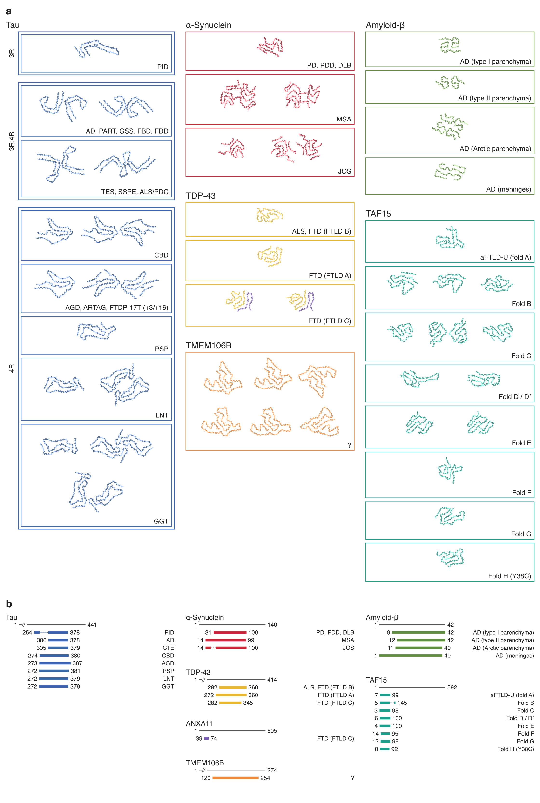

# Amyloid layers

Draws one cross-sectional layer (Cα trace) of cryo-EM amyloid filament structures, laid out
as an overview figure (tau, α-synuclein, Aβ, TDP-43, TMEM106B, TAF15 ...).

## Make the figure

1. Edit `figure.yaml` (open it in TextEdit or VS Code). It lists every box, its label,
   and the PDB IDs inside it. To add a new structure, copy a line like `- id: 7P65`
   into the right box and change the ID.
2. In Terminal run:

       ~/Projects/amyloid-layers/make_figure.sh

3. Results in `output/`:
   - `figure.svg`: the editable figure (open in Illustrator/Inkscape). Every structure is its own group named by its PDB ID.
   - `figure.png`: a preview.
   - `structures/`: each structure as its own SVG, same scale and colour.

Any structure that has a problem is listed at the end of the run and shown in red in the figure.

## Adjusting a structure (in figure.yaml)

    - id: 6TJO
      rotate: 90        # turn it (degrees, counter-clockwise)
      flip: true        # mirror image
      chains: [A, B]    # force which chains are drawn
      dots: [[0, 5]]    # cyan dot(s) for extra densities, Å from the centre
      grid: true        # temporary 10 Å grid to help place dots

Tip: change the Illustrator file only for final touches. Anything you want to keep
for next time (rotation, dots, labels) belongs in figure.yaml, because the figure is
rebuilt from scratch on every run.

## Panel b: core-forming residues

Worked out automatically from the residues modelled in each box's structures.
Per family, `protein:` picks the chains (text from the PDB protein name) and
`length:` sets the full length. Per box, `core_label:` gives a shorter label.
Turn panel b off with `core_residues: false`.

## Heteromeric filaments (e.g. ANXA11 + TDP-43)

Add the second protein under `extra_proteins:` in figure.yaml. Its chains are drawn in
its own colour and it gets its own line in panel b.

## Quick contact sheet (older tool)

`ids.txt` + `run.sh` make residue-coloured drawings with numbers, in `output/montage.png`.

Only cryo-EM structures are used; NMR/X-ray entries are skipped.
Downloaded structures are cached in `~/.cache/amyloid_pdb`.
